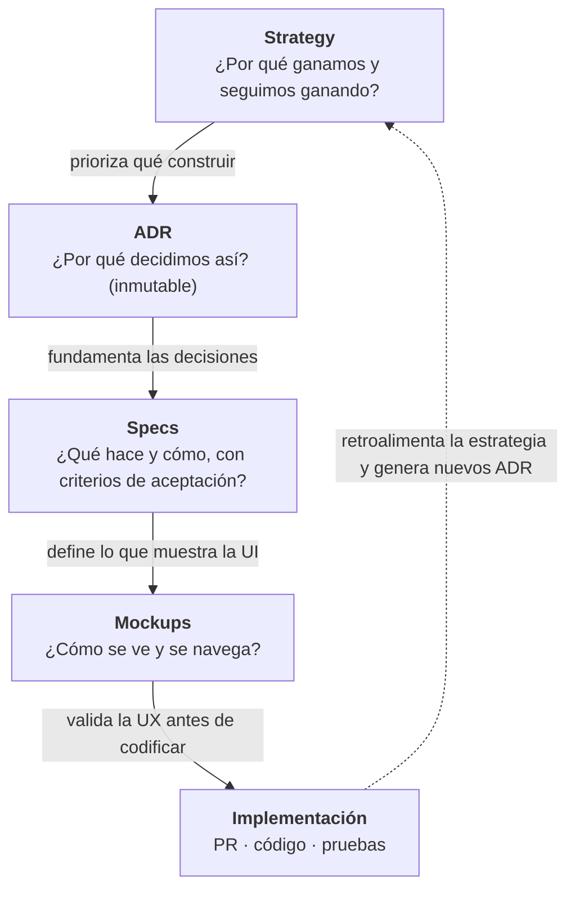
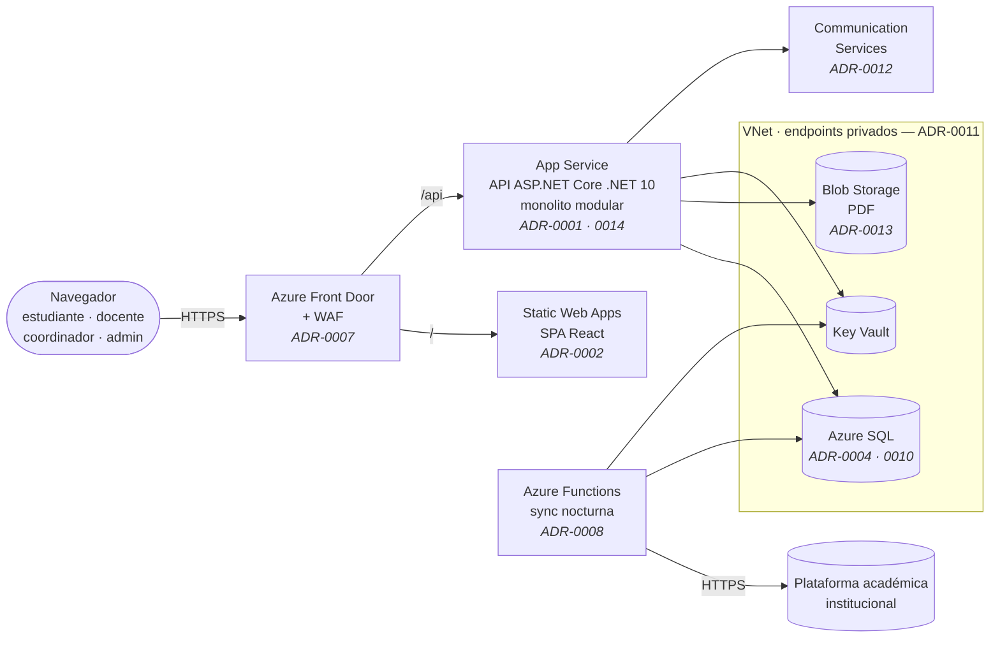

# Sistema de Evaluación de Docentes

Documentación de requisitos, arquitectura y diseño de un sistema web para **evaluar y hacer seguimiento al desempeño docente** en una institución de educación superior.

> Proyecto de clase · **Ingeniería de Requisitos** · Especialización en Ingeniería de Software
> Instituto Tecnológico Metropolitano (ITM) · Medellín, 2026
> **Estudiantes:** Sebastián Vargas Guarin · Alexander Marín Villa — **Docente:** Enrique José González

| Strategy | ADR | Specs | Mockups |
|:---:|:---:|:---:|:---:|
| 1 estrategia + visión | **14** decisiones de arquitectura | **3** specs · **27** criterios de aceptación · **28** casos borde | **3** pantallas HTML navegables · **24** estados |

---

## Contenido

1. [El problema](#1-el-problema)
2. [Cómo está organizada la documentación](#2-cómo-está-organizada-la-documentación)
3. [Strategy: por qué la solución gana y se sostiene](#3-strategy-por-qué-la-solución-gana-y-se-sostiene)
4. [ADR: decisiones de arquitectura](#4-adr-decisiones-de-arquitectura)
5. [Specs: funcionalidades al detalle](#5-specs-funcionalidades-al-detalle)
6. [Mockups: cómo se ve y se navega](#6-mockups-cómo-se-ve-y-se-navega)
7. [Hallazgos y decisiones abiertas](#7-hallazgos-y-decisiones-abiertas)
8. [Trazabilidad con las entregas anteriores](#8-trazabilidad-con-las-entregas-anteriores)
9. [Convenciones para seguir documentando](#9-convenciones-para-seguir-documentando)

---

## 1. El problema

La institución evalúa a sus docentes de forma manual o con herramientas sueltas (hojas de cálculo y formularios desconectados). Eso produce:

| Problema | Consecuencia |
|---|---|
| Falta de trazabilidad histórica | No se ve la evolución de un docente entre periodos. |
| Demoras en la retroalimentación | Los resultados llegan tarde al docente. |
| Problemas de escalabilidad | Cada nueva facultad o sede multiplica el trabajo manual. |
| Riesgos de seguridad y control | Datos confidenciales sin control estricto de roles y permisos (Ley 1581 de 2012). |

**Actores:** Estudiante (evalúa), Docente (consulta sus resultados de forma anónima), Directivo/Coordinador (revisa y consolida), Administrador (configura periodos, usuarios y rúbricas).

**Fuera del alcance:** nómina o pagos, reportes dinámicos a la medida, pasarelas de pago y acceso público a personas externas.

---

## 2. Cómo está organizada la documentación

La documentación sigue los cuatro artefactos de la guía *Strategy, ADR, Specs, Mockups*, **de lo general a lo detallado**:



```text
docs/
├─ README.md                     índice, reglas de cada artefacto y trazabilidad
├─ 01-strategy/
│   strategy.md · vision.md · template.md
├─ 02-adrs/                      consecutivos, globales, inmutables
│   0001 … 0014 · template.md
├─ 03-specs/                     una por funcionalidad
│   0001-iniciar-sesion.md · 0002-crear-rubrica.md · 0003-diligenciar-evaluacion.md · template.md
└─ 04-mockups/                   HTML autocontenido · mismo número que su spec
    0001-iniciar-sesion.html · 0002-crear-rubrica.html · 0003-diligenciar-evaluacion.html · template.md
```

| Artefacto | Va aquí | **No** va aquí |
|---|---|---|
| Strategy | Defensibilidad, evidencia, amenazas, métricas | Decisiones técnicas o requisitos |
| ADR | Stack, arquitectura, base de datos, API, autenticación, despliegue, *build vs buy* | El detalle de una pantalla o funcionalidad |
| Specs | Reglas, contratos de API, flujos, estados, casos borde, criterios de aceptación | La arquitectura o lo visual |
| Mockups | Layout, navegación, estados, componentes, responsive, accesibilidad | La lógica o los contratos de datos |

Índice completo: [docs/README.md](docs/README.md)

---

## 3. Strategy: por qué la solución gana y se sostiene

📄 [strategy.md](docs/01-strategy/strategy.md) · [vision.md](docs/01-strategy/vision.md)

> **Visión:** que cada periodo la institución sepa, a tiempo y con evidencia confiable, cómo enseñan sus docentes, y que cada docente reciba retroalimentación anónima, oportuna y comparable en el tiempo.

**Tesis:** la solución gana frente a seguir con hojas de cálculo, usar formularios genéricos o esperar un módulo de la plataforma académica porque es la única que **sabe quién puede evaluar a quién** (matrículas reales), **protege al estudiante** (anonimato y auditoría) y **acumula un histórico comparable** periodo tras periodo.

| Tipo de defensibilidad | Tesis | Cómo se demuestra |
|---|---|---|
| **Datos** | Cada periodo suma al histórico del docente; una herramienta nueva empieza sin pasado. | % de docentes con 2 o más periodos en el sistema. |
| **Costos de cambio** | Rúbricas, calendario, usuarios capacitados y reportes en uso hacen costoso volver atrás. | Periodos seguidos sin hojas de cálculo paralelas. |
| **Plataforma (integración)** | Solo el sistema garantiza "una evaluación por estudiante matriculado". | Evaluaciones duplicadas o de no matriculados = 0. |
| **Regulación y confianza** | Ley 1581, anonimato y bitácora: evidencia válida para acreditación. | Incidentes de exposición de identidad = 0. |
| ~~Red, escala, marca~~ | Descartadas explícitamente: no aplican a un sistema interno. | — |

Además incluye **7 amenazas** con su señal de alerta, **6 acciones** para profundizar la ventaja y **8 métricas** con línea base y meta. Todas las ventajas quedan marcadas como **hipótesis** hasta medirlas, porque *una ventaja sin evidencia es solo una hipótesis*.

---

## 4. ADR: decisiones de arquitectura

📁 [docs/02-adrs](docs/02-adrs/)

Cada ADR registra **una** decisión con su contexto, la decisión, las alternativas descartadas y sus consecuencias (positivas y negativas).

| ADR | Decisión | Estado |
|---|---|---|
| [0001](docs/02-adrs/0001-monolito-modular-por-epicas.md) | Monolito modular con **un componente por épica** (trazabilidad HU → código) | ✅ Aceptado |
| [0002](docs/02-adrs/0002-spa-react-y-api-rest.md) | SPA en **React** + API **REST/JSON** sobre HTTPS | ✅ Aceptado |
| [0003](docs/02-adrs/0003-backend-aspnet-core-net8.md) | Backend en ASP.NET Core sobre .NET 8 | ⛔ Superado por 0014 |
| [0004](docs/02-adrs/0004-azure-sql-database-y-ef-core.md) | **Azure SQL Database**; acceso solo vía EF Core; unicidad en la base de datos | ✅ Aceptado |
| [0005](docs/02-adrs/0005-nube-microsoft-azure.md) | Alojar en **Microsoft Azure** (frente a AWS, GCP y servidor propio) | ✅ Aceptado |
| [0006](docs/02-adrs/0006-region-east-us-2.md) | Región **East US 2** | ⚠️ Aceptado, condicionado a jurídica |
| [0007](docs/02-adrs/0007-topologia-paas-con-front-door.md) | Topología PaaS con **Front Door + WAF** como única entrada | ✅ Aceptado |
| [0008](docs/02-adrs/0008-sincronizacion-nocturna-con-plataforma-academica.md) | **Sincronización nocturna** con la plataforma académica (no consultas en línea) | ✅ Aceptado |
| [0009](docs/02-adrs/0009-autenticacion-local-con-cedula.md) | Autenticación local con **cédula y contraseña** (SSO queda para después) | 🟡 Propuesto |
| [0010](docs/02-adrs/0010-anonimato-por-separacion-de-participacion-y-respuestas.md) | **Anonimato por diseño:** separar la participación de las respuestas | 🟡 Propuesto |
| [0011](docs/02-adrs/0011-secretos-en-key-vault-y-endpoints-privados.md) | Secretos en **Key Vault** con identidad administrada + **endpoints privados** | ✅ Aceptado |
| [0012](docs/02-adrs/0012-correo-con-azure-communication-services.md) | Correo con **Azure Communication Services** (*buy*, no *build*) | ✅ Aceptado |
| [0013](docs/02-adrs/0013-reportes-pdf-generados-en-servidor.md) | **PDF generados en el servidor** y guardados en Blob Storage | 🟡 Propuesto |
| [0014](docs/02-adrs/0014-actualizar-a-net-10-lts.md) | **.NET 10 LTS** en lugar de .NET 8 | 🟡 Propuesto |

*Aceptado* = decisión ya tomada en la Actividad 4. *Propuesto* = decisión nueva derivada de los requisitos, pendiente de validar.

### La arquitectura que resulta de los ADR



**Ejemplo de decisión de fondo (ADR-0010):** el estudiante debe evaluar *una sola vez* (el sistema necesita saber quién evaluó), pero el docente no debe saber *quién respondió qué*. Se resuelve guardando por separado la **participación** (con el estudiante) y la **respuesta** (sin el estudiante ni la hora exacta). El comprobante entrega al estudiante un código cuyo hash es la única forma de volver a encontrar su respuesta: **la llave para reidentificarla la tiene el estudiante, no el sistema**.

---

## 5. Specs: funcionalidades al detalle

📁 [docs/03-specs](docs/03-specs/)

Las tres historias más importantes del proyecto (sin ellas el sistema no cumple su objetivo):

| Spec | Funcionalidad | HU / CU | Contratos API | Casos borde | Criterios |
|---|---|---|---|---|---|
| [0001](docs/03-specs/0001-iniciar-sesion.md) | Iniciar sesión con cédula y contraseña (incluye recuperación) | HU-01 · CU.0001 | 3 endpoints | 9 | 9 |
| [0002](docs/03-specs/0002-crear-rubrica.md) | Crear rúbrica con criterios y ponderaciones (incluye validación del 100 %) | HU-11, HU-14 · CU.0002 | 2 endpoints | 10 | 9 |
| [0003](docs/03-specs/0003-diligenciar-evaluacion.md) | Diligenciar y enviar la evaluación de un docente | HU-16 · CU.0003 | 3 endpoints | 9 | 9 |

Cada spec sigue la misma plantilla:

1. Resumen / objetivo
2. Alcance (dentro / fuera)
3. Requisitos funcionales y no funcionales (seguridad, rendimiento, privacidad, accesibilidad)
4. Datos y contratos (entidades, endpoints, códigos de error)
5. Flujos y estados (con máquina de estados)
6. Casos borde
7. Criterios de aceptación Dado / Cuando / Entonces
8. Riesgos y pendientes

Los criterios CA1–CA6 de cada spec vienen tal cual de las historias de usuario; los siguientes se **derivaron de los casos borde**. Por ejemplo, que un usuario inactivo reciba el mismo mensaje que con una contraseña errada, o que ponderaciones de 33,33 + 33,33 + 33,33 no se acepten.

**La nota de la evaluación (HU-19) quedó especificada:**

```text
nota = Σ ( ponderación del criterio / 100 × promedio de los ítems calificados del criterio )

Ejemplo: 0,30 × 4,5 + 0,40 × 4 + 0,30 × 3 = 3,85 ≈ 3,9 / 5,0
```

---

## 6. Mockups: cómo se ve y se navega

📁 [docs/04-mockups](docs/04-mockups/)

Son archivos **HTML autocontenidos** (sin dependencias externas). Cada uno tiene:

- Una **barra de estados** para ver todos los estados de la pantalla, no solo el camino feliz.
- Una **ficha desplegable** con las 7 secciones de la plantilla: objetivo, flujo, estados, componentes, responsive, notas de interacción y aprobación del responsable.
- **Navegación real** entre pantallas: el inicio de sesión lleva al estudiante (0003) o al administrador (0002), y «Cerrar sesión» vuelve al inicio.

| Mockup | Estados que muestra | Interacción |
|---|---|---|
| [0001 · Iniciar sesión](docs/04-mockups/0001-iniciar-sesion.html) | Inicial · Validando · Cédula inválida · Credenciales inválidas · Cuenta bloqueada · Éxito · Solicitar enlace · Enlace enviado · Nueva contraseña con error (**9**) | Mostrar/ocultar contraseña; validación de formato; contraseña de demostración `Clave#2026` |
| [0002 · Crear rúbrica](docs/04-mockups/0002-crear-rubrica.html) | Listado vacío · Listado · Formulario · No suma 100 % · Campos faltantes · Guardando · Guardada (**7**) | Total de ponderaciones en vivo; agregar o quitar criterios e ítems |
| [0003 · Diligenciar evaluación](docs/04-mockups/0003-diligenciar-evaluacion.html) | Cargando · Diligenciando · Ítem obligatorio · Borrador · Enviando · Enviada · Periodo cerrado · Ya evaluado (**8**) | Avance y nota parcial en vivo; validación de obligatorios con «Ir al ítem» |

**Cómo verlos:** GitHub muestra el código del HTML, no la pantalla. Descarga el archivo y ábrelo en el navegador, o activa GitHub Pages (abajo). Un estado se puede enlazar directamente con `#estado`, por ejemplo `0003-diligenciar-evaluacion.html#error-obligatorio`.

**Sistema de diseño** (de la guía de Figma de la Actividad 4): azul institucional `#0B3D66`, amarillo `#F2A900`, fuente Inter, campos y botones de 44 px, esquinas de 8/12 px y estados de error, éxito y borrador con sus colores.

**Responsive y accesibilidad:** cada mockup define breakpoints (≤ 1180, ≤ 960, ≤ 600 px), opciones táctiles de 44 × 44 px en móvil, foco visible, uso completo con teclado, `aria-invalid`, `role="alert"` y avisos `aria-live`.

<details>
<summary><b>Ver los mockups en línea con GitHub Pages</b></summary>

1. En el repositorio: **Settings → Pages**.
2. En *Source* elige **Deploy from a branch**, rama `main` y carpeta `/ (root)`. Guarda.
3. En uno o dos minutos quedan disponibles en:
   - `https://sebastianv07.github.io/evaluacion-docentes/docs/04-mockups/0001-iniciar-sesion.html`
   - `https://sebastianv07.github.io/evaluacion-docentes/docs/04-mockups/0002-crear-rubrica.html`
   - `https://sebastianv07.github.io/evaluacion-docentes/docs/04-mockups/0003-diligenciar-evaluacion.html`

</details>

---

## 7. Hallazgos y decisiones abiertas

Al armar la documentación aparecieron puntos que no estaban resueltos en las entregas anteriores:

| # | Hallazgo | Dónde quedó |
|---|---|---|
| 1 | **.NET 8 terminó su soporte LTS el 10 de noviembre de 2026**, y es la versión del diagrama de despliegue. Se registró la decisión original y se superó con .NET 10 LTS, sin editarla ni borrarla. | [ADR-0003](docs/02-adrs/0003-backend-aspnet-core-net8.md) → [ADR-0014](docs/02-adrs/0014-actualizar-a-net-10-lts.md) |
| 2 | **HU-27** se llama "Publicar en el servidor institucional", pero la decisión fue Azure. Hay que renombrarla en Jira. | [ADR-0005](docs/02-adrs/0005-nube-microsoft-azure.md) |
| 3 | Los datos personales quedan **fuera de Colombia** (East US 2): se necesita el aval de jurídica (Ley 1581) antes de producción. | [ADR-0006](docs/02-adrs/0006-region-east-us-2.md) |
| 4 | El anonimato no puede depender solo de permisos; se propone garantizarlo con el diseño de los datos. | [ADR-0010](docs/02-adrs/0010-anonimato-por-separacion-de-participacion-y-respuestas.md) |
| 5 | En grupos pequeños el consolidado puede delatar a quien respondió: falta definir un mínimo de respuestas para publicar. | [ADR-0010](docs/02-adrs/0010-anonimato-por-separacion-de-participacion-y-respuestas.md), [Spec 0003](docs/03-specs/0003-diligenciar-evaluacion.md) |
| 6 | Hay **13 preguntas para el Product Owner** (longitud de la contraseña, bloqueo por intentos, decimales en las ponderaciones, usuarios con dos roles, entre otras). | Sección 8 de cada spec |
| 7 | La pantalla de rúbricas no tenía prototipo; se diseñó en esta entrega. | [Mockup 0002](docs/04-mockups/0002-crear-rubrica.html) |

---

## 8. Trazabilidad con las entregas anteriores

Todo lo de esta documentación sale de las actividades anteriores del curso:

| Entrega anterior | Dónde quedó aquí |
|---|---|
| **Actividad 2** — Problema, necesidades, alcance y actores | [Strategy](docs/01-strategy/strategy.md) y sección *Alcance* de cada spec |
| **Actividad 2** — Casos de uso CU.0001, CU.0002, CU.0003 | [Spec 0001](docs/03-specs/0001-iniciar-sesion.md), [0002](docs/03-specs/0002-crear-rubrica.md), [0003](docs/03-specs/0003-diligenciar-evaluacion.md) |
| **Actividad 3** — Épicas EP-01 a EP-07 e historias de usuario | [ADR-0001](docs/02-adrs/0001-monolito-modular-por-epicas.md) (un componente por épica) |
| **Actividad 3** — Criterios de aceptación de HU-01, HU-11, HU-16 | CA1–CA6 de cada spec |
| **Actividad 3** — Estimación: 818 h, 5 sprints, $89.214.568 COP | [Strategy](docs/01-strategy/strategy.md) (evidencia de costo) |
| **Actividad 4** — Figma, prototipos HU-01 y HU-16, guía de estilos | [Mockups 0001 y 0003](docs/04-mockups/), [sistema de diseño](docs/04-mockups/template.md) |
| **Actividad 4** — Diagramas BPMN | Flujos de las specs y [ADR-0008](docs/02-adrs/0008-sincronizacion-nocturna-con-plataforma-academica.md) |
| **Actividad 4** — Diagramas de componentes y de despliegue en Azure | [ADR-0001 a ADR-0014](docs/02-adrs/) |

---

## 9. Convenciones para seguir documentando

- **Carpetas numeradas** 01 → 04, de lo general a lo detallado.
- **ADR:** `NNNN-titulo.md`, consecutivo global. **No se editan**: si una decisión cambia, se crea uno nuevo y el anterior se marca *Superado por ADR-NNNN*.
- **Specs:** `NNNN-feature.md`. Sin criterios de aceptación no está lista. Referencia los ADR que la fundamentan.
- **Mockups:** `NNNN-feature.html` con el **mismo número que su spec**; autocontenido y navegable. La aprobación del Product Owner es el paso previo a codificar.
- Cada carpeta tiene su `template.md` para empezar un documento nuevo.
- Cada pull request enlaza la spec o el ADR que implementa.

---

<sub>Referencias: ISO/IEC/IEEE 29148:2018 · Cohn (2004, 2005) · Patton (2014) · Schwaber y Sutherland (2020) · OMG BPMN 2.0.2 y UML 2.5.1 · Ley Estatutaria 1581 de 2012.</sub>
